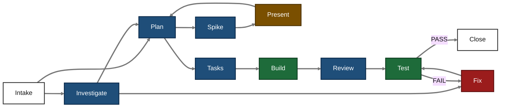

# feature-flow

Each stage exists to remove one kind of uncertainty; its artefact is the next stage's input. The flow is a guide, not a pipeline: the user may enter, skip, repeat or reorder any stage.

## Flow

## Stages

| # | Stage | Agent | Removes uncertainty about | Reads | Writes (in `DOCS_DIR`) | Exit gate |
|---|---|---|---|---|---|---|
| 0 | Intake | first agent invoked | where work lives | request, Jira key/URL | folder, `jira.json` | `DOCS_FOLDER` resolved |
| 1 | Investigate | investigate · investigate-apex | cause | symptom, logs, data, changes | `investigation-*/report.md` | root cause High confidence, or unknowns stated |
| 2 | Plan | generate-plan | what + why (business) | Jira card, report, spike decisions | `plan.md` | Readiness Check ✅ |
| 3 | Spike | spike-plan | whether / how it can be built | `plan.md` | `spike.md`, `spike-report.md` | every Goal answered or blocked with reason |
| 4 | Present | presentation-deck | which option the team picks | all artefacts | `presentation.md` | self-check ✅ · decisions recorded by user |
| 5 | Tasks | generate-task | how to build, in what order | plan, spike, report, Figma | `task-NNN.md` (+ `blueprint.md`) | Coverage/Consistency Check ✅ |
| 6 | Build | execute-task | does the code work | `task-NNN.md` | code, MR | tests ✅ · pipeline ✅ · 0 open threads |
| 7 | Review | git-review → git-fix-review | is the code right | MR diff, Jira AC | MR threads | approved, 0 Critical/Major |
| 8 | Test | testing-task | does it work in a real env, nothing regressed | MR, AC, tasks | `TEST-REPORT.md`, `test-artifacts/` | verdict PASS |
| 9 | Fix | fix-task | why it deviated + correction | issues, `TEST-REPORT.md`, report | `fixes/fix-*.md`, MR | tests ✅ · pipeline ✅ |
| 10 | Close | agent ending stage 8 | nothing left open | all | Jira update, `KNOWN-ISSUES.md` | env released · Jira updated (user yes) |

## ROUTE (entry point)

| Request | Start at |
|---|---|
| New feature / change, requirements clear | 2 Plan |
| Feature with unknown tech, feasibility or options | 2 Plan → 3 Spike |
| Greenfield app | 2 Plan (greenfield) → 5 Tasks (`blueprint.md` first) |
| Bug / incident / "why did X happen", cause unknown | 1 Investigate |
| Bug with known cause, `plan.md`/`task-*.md` exist | 9 Fix |
| Bug with known cause, no docs | 2 Plan (small scope) |
| Review someone's MR | 7 Review |
| Verify a card / MR on dev/qa/staging | 8 Test |
| Share findings with tech + non-tech audience | 4 Present |

## SUGGEST_NEXT

**Inputs:** `STAGE`, `OUTCOME`, `DOCS_DIR` → **Output:** next-step suggestion (advisory only)

1. Pick the row for `STAGE` + `OUTCOME` below
2. EMIT: `Next: @<agent> <exact path/URL>` + one-line reason; several valid → numbered list, most likely first
3. Suggest only — never start the next agent or block finishing on it; the user decides whether, when and which
4. Omit agents/skills not present in this workspace (see Availability)

| Stage | Outcome | Next |
|---|---|---|
| 1 Investigate | root cause, fix is small and docs exist | fix-task `<DOCS_DIR>` + report path |
| 1 Investigate | root cause, change needs scoping | generate-plan with report path |
| 1 Investigate | unresolved / needs team decision | presentation-deck `<DOCS_DIR>` |
| 2 Plan | blocking technical Open Question or unfamiliar tech | spike-plan `<plan.md>` |
| 2 Plan | ready | generate-task `<plan.md>` |
| 3 Spike | done | presentation-deck `<DOCS_DIR>` → then generate-plan Refine with decisions |
| 4 Present | decisions made | generate-plan Refine `<plan.md>` with decisions |
| 5 Tasks | generated | execute-task `<DOCS_DIR>/task-001.md` (greenfield: `approve blueprint` first) |
| 6 Build | MR green, more tasks | execute-task next `task-NNN.md` whose prerequisites are done |
| 6 Build | MR green, slice testable | testing-task `<task-NNN.md>` · git-review `<MR_URL>` (peer) |
| 7 Review | findings posted | git-fix-review `<MR_URL>` (author) |
| 7 Review | approved | testing-task `<MR_URL>` |
| 8 Test | PASS | Close: Jira comment/status (jira-ticket), release env (env-chope Release) |
| 8 Test | FAIL | fix-task `<DOCS_DIR>` + `TEST-REPORT.md` |
| 8 Test | BLOCKED | resolve stated blocker, then testing-task again |
| 9 Fix | MR green | testing-task `<DOCS_DIR>` (re-test) |
| 9 Fix | cause still unclear | investigate `<DOCS_DIR>` |

## Skill Registry

Load a skill only when the step needs it. Profile: **all** = every variant · **gobiz** = root + `monorepo/` only (excluded from `general/`) · **workspace** = provided by the host workspace (e.g. `monorepo/skills/`, index `monorepo/docs/skills.md`), use only if present.

| Need | Skill | Profile | Stages |
|---|---|---|---|
| Work folder, naming, `KNOWN-ISSUES.md` | docs-folder | all | every |
| Stage map, hand-off, story points | feature-flow | all | every |
| Gap check before finalising an artefact | deep-think | all | 2, 3, 5, 6, 9 |
| Greenfield detect, blueprint, build phases | app-blueprint | all | 2, 5, 6 |
| Read card / comments, search past bugs, Confluence runbooks, create/update story + sub-tasks | jira-ticket | all | 0–3, 5, 8–10 |
| Figma layout, tokens, UX flow (cache in `figma/`) | figma-design-context | all | 2, 3, 5, 6, 9 |
| Audience-ready discussion doc | presentation-deck | all | 3, 4 |
| Preflight: VPN, SSO, tokens | integration-health | gobiz | before first networked skill |
| Application logs, error rates, traces | opensearch-logs | gobiz | 1, 3, 8, 9 |
| Data state, schema, volumes (prod read-only) | postgres-query | gobiz | 1, 3, 5, 8, 9 |
| ECS / RDS / SQS / CloudWatch / infra limits | aws-access | gobiz | 1, 3 |
| Deploys + merges around an onset time | change-timeline | gobiz | 1, 9 |
| Branch, worktree, commit, MR, pipeline loop | git-workflow | gobiz | 6, 7, 9 |
| MR/PR threads, comments, CI job logs | git-apis | gobiz | 1, 6–9 |
| Reserve / release lower env, MR impact, Flyway | env-chope | gobiz | 5, 8, 10 |
| BEFORE/AFTER evidence testing | qa-evidence-testing | gobiz | 8 |
| APEX gateway failures | investigate-apex | gobiz | 1 |
| Library/framework docs at the pinned version | live-docs | workspace | 3, 5, 6 |
| Drive a browser to verify UI | web-exploration | workspace | 6, 8 |
| Consumers of a shared contract / package | blast-radius · factory-graph-query · `service-graph.json` | workspace | 1, 3, 5, 6, 7 |
| MR diff vs Jira AC | mr-evaluation | workspace | 7 |
| Incident discussions | slack-search | workspace | 1 |

Side workflows (outside the feature flow): apex-onboarding · cft-agency-onboarding (cft-onboarding) · env-chope (agent) · fix-vulnerabilities.

### Availability

- Available = its `SKILL.md` exists in `.github/skills/` or `.claude/skills/`, or is listed in the workspace skill index
- Unavailable → skip that step and state `skipped — <skill> unavailable` in the output; never emulate a skill from memory
- Networked skill → run integration-health `--net --only <name>` once per session before first use (when available); failure → apply its "On failure" action, don't continue blind

## Story Points

One scale for the whole flow (plan, spike-report, presentation, Jira). Estimate holistically: layers touched × regression risk × uncertainty.

| SP | Category | Signal |
|---|---|---|
| 0.5 | Tiny | One file/config; no logic; near-zero risk |
| 1 | Small | Existing path; basic correctness |
| 2 | Bounded | New capability in one layer |
| 3 | Moderate | Multi-layer; one sprint; regression checks |
| 5 | Significant | Cross-layer; auth/security; workflow change |

- \> 5 SP for one card → split into cards. Totals across cards may exceed 5
- Source gives SP → use as-is. Source gives days only → show days and SP side by side, never silently convert
- Estimate not from an artefact → label `Estimate for discussion` with its basis

## Shared Rules

- Artefacts flow forward in `DOCS_DIR`; each stage reads every earlier artefact before acting and never re-derives what one already states
- Change an upstream artefact only through its owner (plan → generate-plan Refine · tasks/blueprint → generate-task Refine). Downstream agents may only tick checkboxes, append changelog/warnings, and (fix-task) correct a confirmed AC gap; anything else → list the conflict to the user
- Jira writes only after the user picks the option in a jira-prompt
- PROD: read-only in every stage; deploys and env writes only on DEV / QA / STAGING with explicit yes
