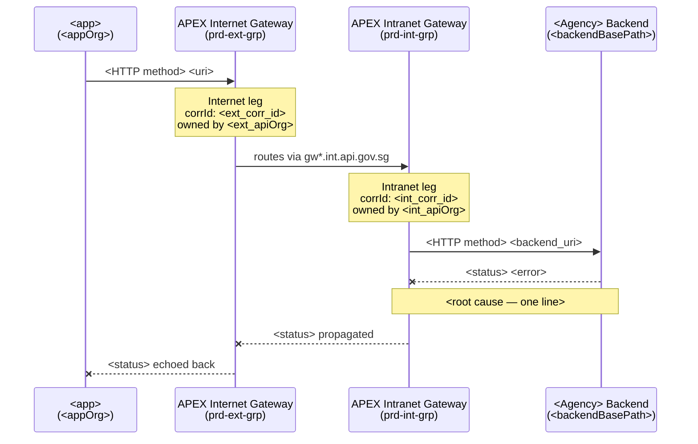

# Investigate APEX

End-to-end APEX log investigation. Accepts loose input (incident description, correlation ID, endpoint, agency name, timeframe) and produces a structured incident report with a Mermaid diagram.

## Credential setup (one-time)

Tokens are read from env vars. They must be present in `~/.zshenv`:

```
APEX_LOG_TOKEN_STAGING
APEX_LOG_TOKEN_PROD
```

If missing, tell the user to run:
```bash
source ~/.zshenv
```
and verify with `echo $APEX_LOG_TOKEN_STAGING` (should be non-empty).  
**Never print the token value.**

---

## Step 0 — Parse input

Accept any of the following (one or more):

| Input type | Example |
|---|---|
| Free-text description | "SPF licence submission failing since Monday" |
| Correlation ID | `4dceb96af3c5d699aa53d56b` |
| Endpoint / URI fragment | `createOPSPP`, `/spf/spfdx/plus2c` |
| Agency | `SPF`, `MOM`, `SCDF` |
| Timeframe | "last 2 hours", "since 9am", "28 Sep" |
| HTTP status | `526`, `504`, `401` |

Set environment:
- Default to **staging** unless user says "prod" or "production"
- Set `TOKEN` and `ES_URL` accordingly:

```bash
# Staging
TOKEN="$APEX_LOG_TOKEN_STAGING"
ES_URL="https://gvt-gds-apex-apex-stg.es.ap-southeast-1.aws.found.io"

# Production
TOKEN="$APEX_LOG_TOKEN_PROD"
ES_URL="https://gvt-gds-apex-apex-prod.es.ap-southeast-1.aws.found.io"
```

If token is empty: stop and tell user to `source ~/.zshenv`.

---

## Step 1 — Search traffic summary

Build a query from the parsed input. Use `match_phrase` for URI fragments. Keep filters **loose** — avoid over-filtering, which hides evidence.

```bash
curl -s -H "Authorization: ApiKey $TOKEN" \
  -H "Content-Type: application/json" \
  "$ES_URL/apigw-traffic-summary*/_search" \
  -d '{
    "size": 10,
    "sort": [{"@timestamp": "desc"}],
    "query": {
      "bool": {
        "must": [
          <uri filter if provided>,
          <time range if provided — default now-24h>,
          <status filter only if user explicitly asked for failures>
        ]
      }
    }
  }'
```

**Filter construction rules:**
- URI: `{"match_phrase": {"http.uri": "<fragment>"}}`
- Agency (maps to apiOrg): `{"match_phrase": {"serviceContext.apiOrg": "<AGENCY>-<DEPT>"}}`  
  Common mappings: `SPF` → `SPF-SPFDX`, `MOM` → `MOM-IPNO`, `SCDF` → `SCDF-SCDF`  
  If unsure of exact org, search without agency filter first
- Status: `{"term": {"finalStatus": "Fail"}}` — only add if user asked for failures
- Time: `{"range": {"@timestamp": {"gte": "now-24h"}}}` — widen to `now-7d` if no results
- Correlation ID: skip summary search, go directly to Step 2

Display results as a table:

| Time (SGT) | correlationId | Gateway | Status | App | Duration | URI |
|---|---|---|---|---|---|---|

SGT = UTC+8. Auto-dive into the most recent failure — don't wait for user to pick.

---

## Step 2 — Deep-dive correlation ID

Query traffic-details for Leg 0 (inbound) and Leg 1 (outbound):

```bash
curl -s -H "Authorization: ApiKey $TOKEN" \
  -H "Content-Type: application/json" \
  "$ES_URL/apigw-traffic-details*/_search" \
  -d '{
    "size": 5,
    "query": {"term": {"correlationId": "<CORR_ID>"}}
  }'
```

**Detect bridging (Internet → Intranet):**
- Check `transactionElements.leg1.protocolInfo.recvHeader` for `X-CorrelationID: Id-<internal-corr-id>`
- If found → bridged request. Extract the internal correlation ID and repeat this step for the internal leg.
- If `leg1.remoteName` is `gw-stg.int.api.gov.sg` (staging) or `gw.int.api.gov.sg` (prod) → bridged.

**Bridging summary:**

| Pattern | What it means |
|---|---|
| External leg1 → `gw*.int.api.gov.sg` | Bridged — route crosses from Internet to Intranet gateway |
| No `X-CorrelationID` in leg1 header | Non-bridged — request goes directly to backend |
| Internal has no leg1 | Failure at Intranet gateway auth — backend never reached |

---

## Step 3 — Get root cause from trace

Query trace logs using the **Internal** correlation ID for bridged requests (External trace has no detail):

```bash
curl -s -H "Authorization: ApiKey $TOKEN" \
  -H "Content-Type: application/json" \
  "$ES_URL/apigw-traffic-trace*/_search" \
  -d '{
    "size": 20,
    "sort": [{"@timestamp": "asc"}],
    "query": {"term": {"correlationId": "<CORR_ID>"}}
  }'
```

Look for:
- `"Filter that caused failure:"` — contains the full policy chain with PASSED/FAILED
- `"SSL protocol error"` / `certificate verify failed` → 526, backend cert issue
- `"timeout while waiting for read"` → 504, backend never responded
- `"Failed to authenticate method"` → auth failure at gateway
- `"No match found for request"` → route not registered on gateway
- `"invokableMethodCircuitFailure"` → APEX circuit breaker tripped (usually follows SSL/timeout)

**Noise to ignore:**
- `"unable to find API key: <uuid>"` — false positive in cross-zone bridging
- `"Retrieve JWKS from HTTP header for CROSS-ZONE: FAILED"` — expected in same-zone requests
- `"Client id: ... is assigned to the wrong security device store"` — non-fatal warning

---

## Step 4 — Compare with a passing request

Fetch one recent **successful** request to the same URI:

```bash
curl -s -H "Authorization: ApiKey $TOKEN" \
  -H "Content-Type: application/json" \
  "$ES_URL/apigw-traffic-summary*/_search" \
  -d '{
    "size": 1,
    "sort": [{"@timestamp": "desc"}],
    "query": {
      "bool": {
        "must": [
          {"match_phrase": {"http.uri": "<URI>"}},
          {"term": {"finalStatus": "Pass"}}
        ]
      }
    }
  }'
```

Use this to answer: intermittent or persistent? Same app? Different time of day?  
Include the last-success timestamp in the verdict.

---

## Step 5 — Failure classification

| HTTP Status | Backend reached? | Meaning | Owner |
|---|---|---|---|
| 526 | Yes | SSL cert verify failed at backend | Backend team (cert expired/invalid) |
| 527 | Yes | Backend disconnected mid-response | Backend team (SSL/resource contention) |
| 504 | Yes | Backend timeout | Backend team |
| 500 | Yes | Backend internal error | Backend team |
| 502 | Yes | Bad gateway / payload >10MB | Check payload size |
| 401/403 (backend) | Yes | Backend rejected (APEX auth passed) | Backend team |
| 401/403 (gateway) | No — Internal has no leg1 | API key not provisioned on Intranet gateway | APEX admin |
| 450 | No | Invalid/unsubscribed API key | Check APEX subscription |
| 452 | No | JWT signature verification failed | Client (key mismatch) |
| 499 | No | JWT token reuse (duplicate jti) | Client (must generate fresh JWT per call) |
| 433–449 (excl. 446) | No | JWT pre-auth error | Client |
| 446 bridged | Yes | Backend error passed through | Backend team |
| 429 | No | Rate limit exceeded (20 TPS staging) | Client (back-off) |
| 405 | No | Wrong HTTP method | Client |

---

## Step 6 — Generate report

Write a Markdown file to `<DOCS_DIR>/investigation-<identifier>/apex-report.md` (`DOCS_DIR` from docs-folder skill DOCS_FOLDER).  
Use the identifier from: correlation ID prefix, endpoint slug, or date+agency (e.g., `526-spf-28sep`).

### Report structure

````markdown
# APEX Investigation — <title>

**Environment:** Staging / Production  
**Time (SGT):** <timestamp>  
**Endpoint:** `<uri>`  
**Status:** HTTP <code>  
**Affected app:** `<app>`

---

## What happened

<2–3 sentences in plain English. No jargon. What was the user trying to do, what failed, and where.>

---

## Request flow



> For non-bridged flows, omit the INT participant and route directly EXT → BE.

---

## Root cause

<Direct statement of what failed and why. One paragraph max. No hedging.>

**Where the error originates:** Internet gateway / Intranet gateway / Backend  
**Error detail:** `<exact error string from trace>`

---

## Impact

| Field | Value |
|---|---|
| First failure seen | <timestamp SGT> |
| Last success | <timestamp SGT or "none in last 24h"> |
| Pattern | Persistent / Intermittent |
| Requests affected (visible in logs) | <count> |

---

## Action required

**Owner:** <team derived from apiOrg at failure point>  
**Action:** <specific, actionable — what they need to check/fix>

---

## Kibana links

- [Internet leg](<kibana_url>/app/dashboards#/view/<dashboard_id>?_a=(filters:!((query:(match_phrase:(correlationId:'<ext_corr_id>'))))))
- [Intranet leg](<kibana_url>/app/dashboards#/view/<dashboard_id>?_a=(filters:!((query:(match_phrase:(correlationId:'<int_corr_id>'))))))

| Environment | Dashboard ID |
|---|---|
| Staging | `b58d4770-bbf5-11ed-893d-712e0b0e3958` |
| Production | `8de3e006-e458-4879-894c-9c7203ea64d3` |
````

---

## Step 7 — Slack-ready summary

After writing the MD file, output a compact vertical diagram to the conversation (for copy-paste into Slack):

```
<URI> — HTTP <status>
<DD Mon H:MMam/pm> SGT

Client: <app>
  |
  v
┌─ APEX Cloud ──────────────────────────┐
│                                        │
│  Internet / External                   │
│    owned by <ext_apiOrg>               │
│    <ext_service> | Auth <OK/FAIL>      │
│    |                                   │
│    v                                   │
│  Intranet / Internal  << FAIL          │
│    owned by <int_apiOrg>               │
│    <int_service>                       │
│    "<error>"                           │
│                                        │
└────────────────────────────────────────┘
  |
  X Backend not reached

Verdict: <3–4 lines, plain English, no hedging>

Action: <team> to <fix>

Kibana: <filtered link>
```

---

## Quality rules

- **No hallucination** — only state what the logs confirm. If a field is null or missing, say "not available in logs".
- **No hedging** — say "the SSL cert on SPF's backend is invalid", not "it might be related to SSL".
- **Plain English first** — technical detail in the MD, plain summary in the verdict.
- **Always show ownership** — `apiOrg` identifies who needs to act, not who reported the issue.
- **Always check bridging** — never present only the External leg. Auto-follow to Internal.
- **Always compare with a passing request** — intermittent vs persistent changes the urgency.
- **Timestamps in SGT** — all times shown to user must be UTC+8.
- **Output file path** — always tell the user where the MD was written.
