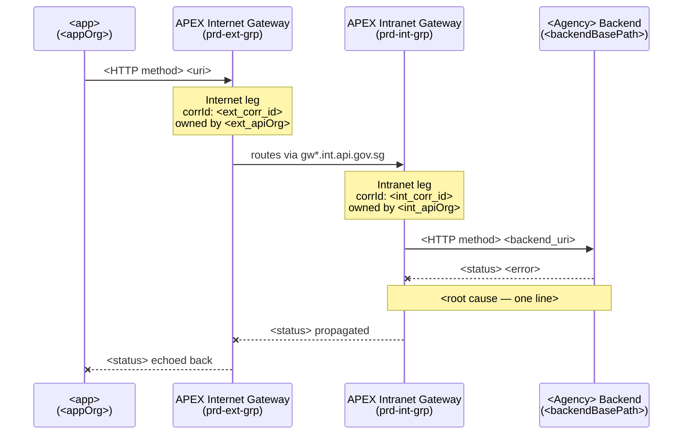

# Investigate APEX

Loose input (incident text, correlation ID, endpoint, agency, timeframe) → structured incident report + Mermaid diagram. Read-only.

## Step 0 — Parse input & set up

| Input | Example |
|---|---|
| Free text | "SPF licence submission failing since Monday" |
| Correlation ID | `4dceb96af3c5d699aa53d56b` |
| Endpoint / URI fragment | `createOPSPP`, `/spf/spfdx/plus2c` |
| Agency | `SPF`, `MOM`, `SCDF` |
| Timeframe | "last 2 hours", "since 9am", "28 Sep" |
| HTTP status | `526`, `504`, `401` |

Env = **staging** unless user says prod/production. Tokens `APEX_LOG_TOKEN_STAGING` / `APEX_LOG_TOKEN_PROD` in `~/.zshenv` (never print). Every call needs network escalation; each command is a fresh process, so define the helper **in the same invocation** as the queries:

```bash
source ~/.zshenv
ES_URL="https://gvt-gds-apex-apex-stg.es.ap-southeast-1.aws.found.io"; TOKEN="$APEX_LOG_TOKEN_STAGING"
# prod: ES_URL="https://gvt-gds-apex-apex-prod.es.ap-southeast-1.aws.found.io"; TOKEN="$APEX_LOG_TOKEN_PROD"
[ -n "$TOKEN" ] || { echo "ERROR: APEX_LOG_TOKEN_* not set — add to ~/.zshenv"; exit 1; }
apex_q() {  # apex_q <index> '<query json>' — read-only _search; token via curl config (not argv); retries 429/5xx
  curl --silent --show-error --fail-with-body --connect-timeout 10 --max-time 60 --retry 3 --retry-max-time 60 \
    -K <(printf 'header = "Authorization: ApiKey %s"\n' "$TOKEN") -H "Content-Type: application/json" \
    "$ES_URL/$1/_search" -d "$2"
}
```

HTTP 401/403 → token expired/wrong env: STOP and ask user to refresh it. Never `-k`.

## Step 1 — Traffic summary (skip if correlation ID given)

```bash
apex_q 'apigw-traffic-summary*' '{"size":10,"sort":[{"@timestamp":"desc"}],"query":{"bool":{"must":[ <filters> ]}}}'
```

Keep filters **loose** (over-filtering hides evidence):
- URI: `{"match_phrase":{"http.uri":"<fragment>"}}`
- Agency → apiOrg: `{"match_phrase":{"serviceContext.apiOrg":"<AGENCY>-<DEPT>"}}` (`SPF`→`SPF-SPFDX`, `MOM`→`MOM-IPNO`, `SCDF`→`SCDF-SCDF`; unsure → omit)
- Status: `{"term":{"finalStatus":"Fail"}}` only if user asked for failures
- Time: `{"range":{"@timestamp":{"gte":"now-24h"}}}`; no hits → `now-7d`

Show `| Time (SGT) | correlationId | Gateway | Status | App | Duration | URI |` (SGT = UTC+8). Auto-dive into the most recent failure.

## Step 2 — Deep-dive correlation ID (legs + bridging)

```bash
apex_q 'apigw-traffic-details*' '{"size":5,"query":{"term":{"correlationId":"<CORR_ID>"}}}'
```

Leg 0 = inbound, Leg 1 = outbound. Bridged (Internet → Intranet) if `transactionElements.leg1.protocolInfo.recvHeader` has `X-CorrelationID: Id-<internal-id>` or `leg1.remoteName` is `gw-stg.int.api.gov.sg` / `gw.int.api.gov.sg` → repeat this step with the internal ID.

| Pattern | Meaning |
|---|---|
| External leg1 → `gw*.int.api.gov.sg` | Bridged, crosses to Intranet gateway |
| No `X-CorrelationID` in leg1 | Non-bridged, direct to backend |
| Internal has no leg1 | Failed at Intranet gateway auth; backend never reached |

## Step 3 — Root cause from trace (use **internal** ID when bridged)

```bash
apex_q 'apigw-traffic-trace*' '{"size":20,"sort":[{"@timestamp":"asc"}],"query":{"term":{"correlationId":"<CORR_ID>"}}}'
```

| Signal | Meaning |
|---|---|
| `Filter that caused failure:` | policy chain with PASSED/FAILED |
| `SSL protocol error` / `certificate verify failed` | 526, backend cert |
| `timeout while waiting for read` | 504, backend silent |
| `Failed to authenticate method` | gateway auth failure |
| `No match found for request` | route not registered |
| `invokableMethodCircuitFailure` | circuit breaker (usually after SSL/timeout) |

Noise: `unable to find API key: <uuid>` (cross-zone bridging), `Retrieve JWKS from HTTP header for CROSS-ZONE: FAILED` (same-zone), `Client id: ... wrong security device store`.

## Step 4 — Compare with a passing request

```bash
apex_q 'apigw-traffic-summary*' '{"size":1,"sort":[{"@timestamp":"desc"}],"query":{"bool":{"must":[{"match_phrase":{"http.uri":"<URI>"}},{"term":{"finalStatus":"Pass"}}]}}}'
```

Intermittent vs persistent? Same app? Time-of-day? Put last-success time in the verdict.

## Step 5 — Failure classification

| HTTP | Backend reached? | Meaning | Owner |
|---|---|---|---|
| 526 | Yes | backend SSL cert verify failed | Backend (cert expired/invalid) |
| 527 | Yes | backend disconnected mid-response | Backend |
| 504 / 500 | Yes | backend timeout / internal error | Backend |
| 502 | Yes | bad gateway / payload >10MB | check payload |
| 401/403 (backend) | Yes | backend rejected (APEX auth passed) | Backend |
| 401/403 (gateway) | No (internal has no leg1) | key not provisioned on Intranet gateway | APEX admin |
| 450 | No | invalid/unsubscribed API key | APEX subscription |
| 452 | No | JWT signature failed | Client (key mismatch) |
| 499 | No | JWT reuse (duplicate jti) | Client (fresh JWT per call) |
| 433–449 (excl. 446) | No | JWT pre-auth error | Client |
| 446 bridged | Yes | backend error passed through | Backend |
| 429 | No | rate limit (20 TPS staging) | Client (back-off) |
| 405 | No | wrong HTTP method | Client |

## Step 6 — Generate report

Write a Markdown file to `<DOCS_DIR>/investigation-<identifier>/apex-report.md` (`DOCS_DIR` from docs-folder skill DOCS_FOLDER).  
Use the identifier from: correlation ID prefix, endpoint slug, or date+agency (e.g., `526-spf-28sep`).

### Report structure

````markdown
# APEX Investigation — <title>

**Environment:** Staging / Production  
**Time (SGT):** <timestamp>  
**Endpoint:** `<uri>`  
**Status:** HTTP <code>  
**Affected app:** `<app>`

---

## What happened

<2–3 sentences in plain English. No jargon. What was the user trying to do, what failed, and where.>

---

## Request flow



> For non-bridged flows, omit the INT participant and route directly EXT → BE.

---

## Root cause

<Direct statement of what failed and why. One paragraph max. No hedging.>

**Where the error originates:** Internet gateway / Intranet gateway / Backend  
**Error detail:** `<exact error string from trace>`

---

## Impact

| Field | Value |
|---|---|
| First failure seen | <timestamp SGT> |
| Last success | <timestamp SGT or "none in last 24h"> |
| Pattern | Persistent / Intermittent |
| Requests affected (visible in logs) | <count> |

---

## Action required

**Owner:** <team derived from apiOrg at failure point>  
**Action:** <specific, actionable — what they need to check/fix>

---

## Kibana links

- [Internet leg](<kibana_url>/app/dashboards#/view/<dashboard_id>?_a=(filters:!((query:(match_phrase:(correlationId:'<ext_corr_id>'))))))
- [Intranet leg](<kibana_url>/app/dashboards#/view/<dashboard_id>?_a=(filters:!((query:(match_phrase:(correlationId:'<int_corr_id>'))))))

| Environment | Dashboard ID |
|---|---|
| Staging | `b58d4770-bbf5-11ed-893d-712e0b0e3958` |
| Production | `8de3e006-e458-4879-894c-9c7203ea64d3` |
````

---

## Step 7 — Slack-ready summary

After writing the MD file, output a compact vertical diagram to the conversation (for copy-paste into Slack):

```
<URI> — HTTP <status>
<DD Mon H:MMam/pm> SGT

Client: <app>
  |
  v
┌─ APEX Cloud ──────────────────────────┐
│                                        │
│  Internet / External                   │
│    owned by <ext_apiOrg>               │
│    <ext_service> | Auth <OK/FAIL>      │
│    |                                   │
│    v                                   │
│  Intranet / Internal  << FAIL          │
│    owned by <int_apiOrg>               │
│    <int_service>                       │
│    "<error>"                           │
│                                        │
└────────────────────────────────────────┘
  |
  X Backend not reached

Verdict: <3–4 lines, plain English, no hedging>

Action: <team> to <fix>

Kibana: <filtered link>
```

---

## Quality rules

- **No hallucination** — only state what the logs confirm. If a field is null or missing, say "not available in logs".
- **No hedging** — say "the SSL cert on SPF's backend is invalid", not "it might be related to SSL".
- **Plain English first** — technical detail in the MD, plain summary in the verdict.
- **Always show ownership** — `apiOrg` identifies who needs to act, not who reported the issue.
- **Always check bridging** — never present only the External leg. Auto-follow to Internal.
- **Always compare with a passing request** — intermittent vs persistent changes the urgency.
- **Timestamps in SGT** — all times shown to user must be UTC+8.
- **Output file path** — always tell the user where the MD was written.
