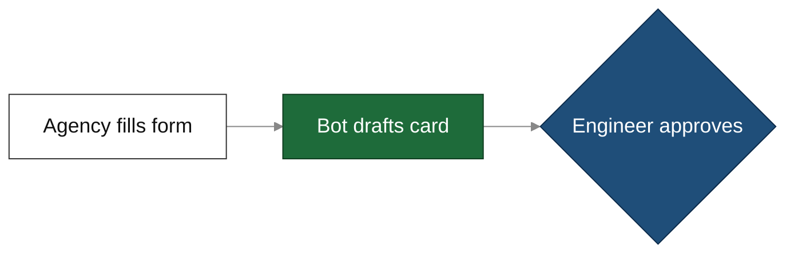

# Presentation Deck

**Input**: `DOCS_DIR` artefacts (+ audience, duration, goal of the meeting) → **Output**: `<DOCS_DIR>/presentation.md`

Load **docs-folder** skill. Never invent facts: every number, claim and risk must trace to an artefact in `DOCS_DIR` or a source read this session.

## Principles (sources)

| Principle | Rule applied here | Source |
|---|---|---|
| Pyramid / answer first | Open with the verdict, then the 3–4 reasons, then detail. Group reasons so they do not overlap and nothing is missing (MECE) | Barbara Minto, *The Pyramid Principle* (barbaraminto.com; Wikipedia "Barbara Minto") |
| Situation → Complication → Question | Use SCQ to frame the problem in 1 slide before the answer | Minto SCQ framework (barbaraminto.com) |
| Assertion–evidence | Slide title = a full-sentence takeaway (not a topic). Body = visual evidence (diagram, table, number), not a bullet list | Michael Alley, assertion-evidence.com |
| Glance test | A slide must be understood in ~3 seconds. If the audience has to read, they stop listening | Nancy Duarte, *slide:ology* |
| Signal-to-noise | Remove everything that doesn't support the one message. Detail lives in the speaker's voice, not on the slide | Garr Reynolds, *Presentation Zen* |
| Markdown slides | `---` separates slides. Front-matter at the top. HTML comments = presenter notes. `_`-prefixed directives apply to one slide | Marpit directives docs (github.com/marp-team/marpit) |
| Diagrams | Mermaid `flowchart TD/LR`, `classDef` with explicit `color:`, `%%{init}%%` theme directive; avoid lowercase `end` in labels | mermaid.js.org flowchart syntax + theming docs |
| Contrast | Text ≥ 4.5:1 against its fill, arrows/borders ≥ 3:1, on both light and dark viewers | WCAG 2.2 SC 1.4.3 / 1.4.11 |

## Phase 1: Frame
- DO: read every artefact in `DOCS_DIR` (plan → spike → spike-report → others). Read the source, never a summary of it
- DO: state 4 things, ask only if missing and not inferable: **Audience** (who decides, who builds) · **Duration** (default 20 min talk + 10 min Q&A) · **Meeting goal** (decide / align / inform) · **Ask** (the exact decisions or actions wanted)
- DO: write the one-sentence **Key message**. If you can't, the deck isn't ready; resolve the conflict first

## Phase 2: Storyline (fixed spine; no jumping)
Slides follow this order. Each one answers the question the previous one raises:

| # | Section | Slide purpose | Typical evidence |
|---|---|---|---|
| 1 | Title | Topic, card, date, presenter, meeting goal | — |
| 2 | Answer first (TL;DR) | Verdict + ≤ 3 reasons + the ask | 3 bullets or 3-row table |
| 3 | Situation | How it works today (as-is) | flowchart TD, step count |
| 4 | Complication | Why it hurts / what changed | numbers |
| 5..n | Findings | One finding per slide, assertion title | table / diagram |
| n+1 | Options | Compared options + recommendation | comparison table |
| n+2 | Target design | Recommended flow / architecture | flowchart LR |
| n+3 | Plan | Phases, estimate, dependencies | table |
| n+4 | Risks & blockers | Top risks only (≤5), owner each | table |
| n+5 | Decisions & asks | Numbered decisions/actions with owners | table |
| — | Appendix | Detail for Q&A only (spec, full question list) | anything |

- ≤ 8 core slides (excl. title + appendix) for 20 min. Fewer, emptier slides beat more, fuller ones: the speaker talks, the slide only anchors. Merge sections (e.g. Situation + Complication, Risks into Plan) rather than exceed
- No breadcrumbs (`[3/9 · Finding]`), no codes (`D1`, `A3`, `2a`), no cross-references between slides — Marp `paginate` already numbers slides

## Phase 3: Write slides
**Main slides are for listening, appendix is for reading.** Anything a dev might want to check later (endpoints, error codes, limits, field names, full question lists, source paths) goes to the appendix or speaker notes — never a `Dev detail` block on a main slide.

Per main slide:
- **Title** = one plain sentence, ≤ 12 words, the takeaway. No semicolons, no second sentence, no jargon/acronyms a PM wouldn't know ("Only 3 of 10 steps can be automated", not "Admin API covers steps 3, 4, 7; PGP/webhook remain manual")
- **Body** = exactly ONE of:
  - a big number + ≤ 1 short line (e.g. `# 52 vs 25` / "workflows we have vs the limit")
  - a table ≤ 4 rows × 3 cols, each cell ≤ 6 words, no sentences in cells
  - a diagram (rules below)
  - ≤ 3 bullets, ≤ 8 words each
- **Word budget**: ≤ 40 words visible on the slide (title + body, excl. notes). Count them. Over budget → cut or move to notes/appendix
- **Plain words**: write for the PM; devs still understand. Say "private network link", not "AWS PrivateLink endpoint". Product/team names are fine; IDs, ticket keys and error codes are not (except the card key on the title slide)
- **Status icons** only where they replace words, max one per cell: ✅ works · 🟡 partial · ❌ no · ⛔ blocker. Don't add a legend slide
- **Speaker notes** in `<!-- … -->` after the body: what to say (2–3 sentences), the transition line, and ≤ 1 likely question + answer. Detail moved off the slide goes here

### Diagrams (readable on light AND dark viewers)
- ≤ 7 nodes, labels ≤ 4 words, no `<br/>`, one direction (`LR` for ≤ 5 nodes, else `TD`). Label an arrow only when the meaning isn't obvious (≤ 3 words)
- Always start with this init line and give **every** node a class — never rely on default theme colours (light fill + inherited light text = unreadable in dark mode):

- Use only these 5 classes (contrast: neutral 18.9:1, human 8.7:1, risk 8.2:1, wait 7.1:1, auto 6.5:1; arrows 3.5:1 on white, 4.7:1 on dark). Every `classDef` MUST set `fill`, `stroke` and `color`. Never use pastel fills (`#fff3cd`, `#d1e7dd`, `#cfe2ff`, …)
- Add a one-line colour key under the diagram only when ≥ 2 colours carry meaning: "Blue = person · Green = automated"
- Marp doesn't render Mermaid natively: note in the deck's title-slide speaker notes that diagrams need VS Code Markdown preview / GitLab, or a Mermaid-enabled Marp setup

### Appendix
- May be dense (tables up to 8 rows, full sentences, endpoints, error codes, sources). Each appendix slide still has one title
- Put here: technical facts, full question lists ready to send, internal questions, sources, anything cut from main slides

## Phase 4: File format
```md
---
marp: true
paginate: true
header: '<card> · <title>'
footer: '<team> · <date>'
---

# <Title>
<subtitle / meeting goal>

<!-- speaker notes -->

---

## <one-sentence takeaway, ≤ 12 words>
<one evidence block>

<!-- notes -->
```
- Renders as a normal Markdown doc in GitLab/VS Code. Renders as slides with the Marp extension/CLI (`marp presentation.md`)

## Phase 5: Self-check (all must pass)
| Check | Pass if |
|---|---|
| Answer first | Slide 2 states the verdict and the ask |
| Squint test | Reading only the slide titles in order tells the full story |
| Glance test | Each main slide's message is clear in ~3 seconds |
| One message | Every slide has exactly one assertion and one evidence block |
| No jump-backs | No slide depends on a later slide. Every reference points backwards or to the appendix |
| Words | Each main slide ≤ 40 visible words. Titles ≤ 12 words, one sentence |
| Density | Main-slide tables ≤ 4 rows × 3 cols, cells ≤ 6 words. Bullets ≤ 3. Diagram ≤ 7 nodes |
| Plain language | No IDs, error codes, codes like `D1`/`2a`, breadcrumbs or `Dev detail` blocks on main slides |
| Contrast | Every Mermaid node has a class from the palette; every `classDef` sets `fill`, `stroke`, `color`; init line present; no pastel fills |
| Traceable | Every number appears in a `DOCS_DIR` artefact |
| Notes | Every core slide has speaker notes with a transition line |
| Ask is concrete | Each decision/action has an owner + due date or "TBD at meeting" |
| Timing | Core slides × 2.5 min ≤ talk duration |

EMIT: path + slide count + estimated talk time + the decisions slide content (so the user can pre-read it).

## Constraints
- Documents only; no Jira/Confluence/Slack writes unless asked
- Mask personal data; never include secrets, tokens or IPs from artefacts
- Update `presentation.md` in place on re-run; don't create variants
