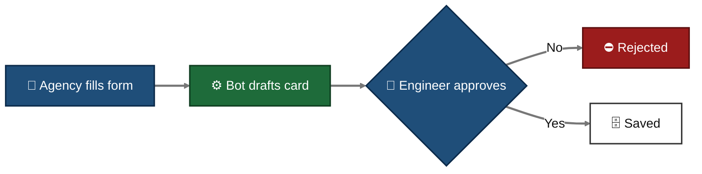

# Presentation Deck

**Input**: `DOCS_DIR` artefacts (+ audience, meeting goal) → **Output**: `<DOCS_DIR>/presentation.md` (+ optional `<DOCS_DIR>/presentation-assets/`)

Load **docs-folder** and **feature-flow** skills. Never invent facts: every number, claim, estimate and risk traces to an artefact in `DOCS_DIR` or a source read this session (cited in section 10 References).

## What this document is

A **discussion and sharing document**, shown as-is on a big screen and sent to anyone afterwards. Readers range from engineers to PMs, ops and business owners. It must:
- Be **public-safe**: no secrets, tokens, IPs, hostnames, personal data, internal-only jokes, presenter notes or tactics
- Be **readable by non-tech** people: every major section opens with a plain-language `> 💡 **In short:**` line; jargon is explained once in the Glossary (Appendix A)
- Be **navigable**: numbered sections + clickable contents menu, so anyone can jump to `4.2` or `5.2.3` during discussion
- Be **visual**: a diagram, table or image wherever it explains faster than words
- Be **decision-oriented**: end with concrete decisions/questions for the group

What is **never** in the file: speaker notes, HTML comments (`<!-- -->`), "Say:", "Likely Q", meeting logistics (agenda, timing, "ask today"), presenter opinions ("my lean is…"), "who might object" commentary, placeholders like `TBD at meeting`.

## First-principles thinking (mandatory)

Applied before writing and visible in the document (section 3.3):

| Step | Question | Output |
|---|---|---|
| 1. Strip assumptions | What do we believe only because "that's how it's done"? | List of assumptions, each marked verified / unverified |
| 2. Fundamentals | What is undeniably true? (user need, hard limits, laws/policy, physics of the system: data volume, latency, cost, ownership) | 3-6 "must be true" statements, each with evidence |
| 3. Rebuild | What is the simplest solution that satisfies only the fundamentals? | Seeds the solution long-list (section 5.1) |
| 4. Challenge | Does each option violate any fundamental? | Eliminated options with the violated fundamental named |

Never pattern-match to "the usual fix". If the obvious approach breaks a fundamental, say so and show why.

## Phase 1: Frame (private — never written into the file)
- DO: read every artefact in `DOCS_DIR` (plan → spike → spike-report → investigations → fixes). Read sources, not summaries of them
- DO: fix 4 things; ask only if missing and not inferable: **Audience** (who decides, who builds, who is affected) · **Meeting goal** (decide / align / inform) · **Ask** (exact decisions wanted) · **Key message** (one sentence)
- IF: you can't write the key message in one sentence → the material conflicts; list the conflict to the user and STOP until resolved
- DO: run the first-principles table above on the artefact content

## Phase 2: Shortlist solutions
- DO: build a long-list of every option found in the artefacts (spike "Alternatives Considered", plan, investigation fix options) + any option derived from fundamentals in step 3
- DO: eliminate options that break a fundamental or are clearly dominated; record the reason (goes to section 5.1)
- DO: keep the **2-3 best** options for discussion. Exactly 1 is marked **Recommended**; never present a single option alone (if only one survives, compare it against "Do nothing / keep today's way")
- DO: for each shortlisted option gather: end-to-end flow, what changes, story points, blockers/dependencies, trade-offs, risks — all from artefacts

### Story points
- Use feature-flow **Story Points** (one scale across plan, spike, deck, Jira). Show the basis per work item; a work item > 5 SP → split it
- Not from an artefact → label the total `Estimate for discussion`

## Phase 3: Write `presentation.md` (fixed structure)

Sections are numbered and always in this order. Drop a sub-section only if it has no content and renumber the rest; never leave an empty heading. Top-level sections 1-10 are always present (write one line "Not applicable — <reason>" if truly empty).

```md
# <Title: plain words, the topic, ≤ 10 words>

> **<Card key>** · <Team> · <Date YYYY-MM-DD> · Status: For discussion

<Description: 2-3 plain sentences — what this is, why we're looking at it, what we want from the audience>

## Contents
- [1. Summary](#1-summary)
  - [1.1 The answer](#11-the-answer)
  - [1.2 What we need from you](#12-what-we-need-from-you)
- [2. Background](#2-background)
  - … every numbered heading down to level 3 (e.g. 5.2.1) …
- [10. References](#10-references)
- [Appendix](#appendix)

---

## 1. Summary
> 💡 **In short:** <one sentence a non-tech reader understands>

### 1.1 The answer
Verdict + ≤ 3 reasons (table or bullets) + link to the recommended option, e.g. [5.2](#52-option-a-...)

### 1.2 What we need from you
The decisions wanted (short list; full table in [9](#9-decisions-needed))

[↑ Back to contents](#contents)

## 2. Background
### 2.1 How it works today
As-is end-to-end flowchart + 1-line caption
### 2.2 Who is involved
Actors/systems table (who · role · impacted how)

## 3. Problem Statement
### 3.1 The problem
Situation → Complication → Question (3 short lines). Who is affected, what breaks, how often
### 3.2 Why it matters
Impact numbers (big number / table): users, time, cost, incidents, risk
### 3.3 What must be true
First-principles fundamentals table: # · Fundamental · Evidence. Plus assumptions challenged (verified ✅ / unverified 🟡 / false ❌)
### 3.4 Scope
In scope / Out of scope (2-col table)

## 4. Hypotheses and Evidence
### 4.1 H1 <hypothesis as a plain statement>
| Hypothesis | How we tested | Evidence | Verdict |
Verdict: ✅ Confirmed · ❌ Rejected · 🟡 Inconclusive. Diagram/screenshot if it proves the point faster
### 4.2 H2 …
### 4.N Research findings
External research table: Topic · Finding · Source link ([10](#10-references))

## 5. Solution Options
### 5.1 All options considered
Long-list table: Option · Kept / Dropped · Why (name the violated fundamental from 3.3)
### 5.2 Option A <name>
> ⭐ **Recommended** (only on the recommended option) · 💡 **In short:** <one plain sentence>
#### 5.2.1 How it works end to end
Flowchart of the full journey (trigger → every actor/system → outcome), then a sequenceDiagram if ≥ 3 systems talk to each other
#### 5.2.2 What changes
| Type (ADD / UPDATE / REMOVE / NO CHANGE) | What | Who notices |
#### 5.2.3 Effort
| Work item | Story points | Basis | + **Total** row
#### 5.2.4 Blockers and dependencies
| Item | Type (⛔ blocker / 🔗 dependency) | Owner team | Unblocks when |
#### 5.2.5 Trade offs
| 👍 Gains | 👎 Costs |
#### 5.2.6 Risks
| Risk | Likelihood | Impact | Mitigation |
### 5.3 Option B <name>
(same 5.3.1-5.3.6)
### 5.4 Option C <name>
Only when 3 options are shortlisted

## 6. Comparison and Recommendation
### 6.1 Side by side
Criteria rows × option columns: fits fundamentals, user impact, story points, time to value, blockers, risk, reversibility, run cost. Use ✅ 🟡 ❌ ⛔
### 6.2 Effort vs value
quadrantChart (or a 2×2 table) placing each option
### 6.3 Why we recommend Option X
3 reasons, each pointing back to evidence (e.g. "see 4.1")

## 7. Delivery Plan
Phases/milestones of the recommended option: table Phase · Scope · SP · Depends on. Optional flowchart of phases. No calendar dates unless an artefact gives them

## 8. Risks, Blockers and Open Questions
### 8.1 Top risks (≤ 5, across the recommendation)
### 8.2 Open questions
| # | Question (public wording) | Why it matters | Who can answer |

## 9. Decisions Needed
| # | Decision / question | Options | Recommended |
Owner column only when already agreed

## 10. References
Numbered list: artefacts in DOCS_DIR as relative links (`[spike.md](./spike.md)`), official docs/standards with URL, related tickets (key only). Every external claim in the doc cites one of these

## Appendix
### A. Glossary
Term · Plain meaning (every acronym/jargon used anywhere above)
### B. Technical detail
Endpoints, configs, limits, error codes, field names, file paths — anything engineers need to verify later
### C. How we estimated
Story-point scale used (feature-flow) + basis per item + assumptions
```

### Writing rules
- **Headings**: `## N. Title`, `### N.M Title`, `#### N.M.K Title`. Only letters, digits, single spaces, commas and the leading number's dots — no emoji, dashes, `/`, `&`, `:`, `(`, `)` or `—` in headings (they break or diverge anchors across GitLab/GitHub/VS Code). Every heading text is unique
- **Anchors**: slug = heading text → lowercase → delete every char except letters, digits, spaces, `-` → spaces to `-`. `### 5.2.1 How it works end to end` → `#521-how-it-works-end-to-end`. Contents lists every heading to level 4 (`####`) except `Contents`; each top-level section ends with `[↑ Back to contents](#contents)`
- **Cross-references**: cite by section link, e.g. `proved in [4.1](#41-h1-<slug>)`. Forward links allowed only from 1 Summary, or to 10 References and the Appendix
- **Plain first, detail after**: each `##` starts with the `> 💡 **In short:**` line; technical depth lives in the sub-sections and Appendix B. Explain each acronym on first use or link to `[Glossary](#a-glossary)`
- **Paragraphs** ≤ 3 sentences. Prefer table > bullets > prose. Table cells ≤ 12 words
- **Icons** carry meaning, one per cell max: ✅ yes/works · 🟡 partial · ❌ no · ⛔ blocker · 🔗 dependency · ⭐ recommended · 👤 person · ⚙️ automated · 🗄️ data store · 🌐 external system
- **Tone**: neutral and factual; state options and the recommendation with evidence, never persuasion tactics

### Visuals
Every option's 5.x.1 MUST have an end-to-end flowchart. Sections 2.1 and 6.2 SHOULD have one. Add more wherever a picture explains faster.

| Visual | Use for | Mermaid |
|---|---|---|
| End-to-end flow | journeys, as-is vs to-be | `flowchart LR` (≤ 6 nodes) / `TD`, ≤ 12 nodes, `subgraph` per actor/system |
| Interaction | ≥ 3 systems exchanging calls | `sequenceDiagram`, ≤ 6 participants |
| Effort vs value | option comparison | `quadrantChart` |
| Phases | delivery plan | `flowchart LR` of phases (no dates) |
| Share / volume | where time/cost/errors go | `pie` |

Flowchart template — always the init line, a class on **every** node, the `linkStyle` line (readable in light AND dark viewers and on a projector):

- Only these 5 classes (text contrast ≥ 6.5:1; WCAG 2.2 SC 1.4.3/1.4.11). Every `classDef` sets `fill`, `stroke`, `color`. No pastel fills. Labels ≤ 5 words, no `<br/>`, never a bare lowercase `end` in a label
- Colour key line under any diagram where ≥ 2 colours carry meaning: "Blue = person · Green = automated · Amber = waiting · Red = blocked/risk"
- sequenceDiagram: start with `%%{init: {'theme':'base','themeVariables':{'fontSize':'16px','actorBkg':'#1f4e79','actorTextColor':'#ffffff','actorBorder':'#0b2a4a','signalColor':'#777777','signalTextColor':'#111111','noteBkgColor':'#ffffff','noteTextColor':'#111111','noteBorderColor':'#333333'}}}%%`
- Caption every visual with one italic line stating what it shows

**Images / illustrations**
- Reuse images already in `DOCS_DIR` (e.g. `figma/` cache, investigation screenshots) via relative path: ``. New images go in `<DOCS_DIR>/presentation-assets/`
- Every image has meaningful alt text + an italic caption. Mask personal data, tokens, hostnames before use
- Never hotlink external images or invent screenshots/mock-ups that don't exist

## Phase 4: Self-check (all must pass before EMIT)
| Check | Pass if |
|---|---|
| Structure | Sections 1-10 + Appendix present in order; 2-3 options in 5; exactly one ⭐ Recommended |
| First principles | 3.3 lists fundamentals with evidence; every dropped option in 5.1 names the fundamental it breaks |
| Hypotheses | Each H has test + evidence + verdict; no ✅ without evidence |
| Option completeness | Every shortlisted option has 5.x.1-5.x.6 incl. an end-to-end flowchart and an SP total |
| Links | Every `](#...)` matches a heading slug (rule above); Contents covers all `##`-`####` headings; every relative file link/image exists |
| Headings | No emoji, `-`, `/`, `&`, `:`, `(`, `)`, `—` in headings; all unique |
| Non-tech | Every `##` has the `In short` line; every acronym is explained or in the Glossary |
| Squint test | Reading the `In short` lines alone tells the whole story |
| Visual contrast | Every Mermaid node has a palette class; init + `linkStyle default` present; no pastel fills |
| Traceable | Every number/estimate traces to an artefact or is labelled "Estimate for discussion" with its basis |
| Public-safe | grep: zero `<!--`, `Say:`, `Likely Q`, `Transition`, `my lean`, `meeting goal`, `TBD at meeting`; no secrets/IPs/hostnames/personal data |
| Decisions | 9 lists concrete questions with options and the recommendation |

EMIT: path · section count · options shortlisted (+ recommended) · SP totals per option · the Decisions table (for pre-read) · viewer note (needs a Mermaid-capable viewer: GitLab, GitHub, or VS Code Markdown preview with Mermaid) · artefact conflicts found.

## Constraints
- Documents only; no Jira/Confluence/Slack writes unless asked
- Never edit other artefacts unless asked — list conflicts instead
- Update `presentation.md` in place on re-run; don't create variants
- After EMIT → CALL: SUGGEST_NEXT(Present, decisions made) — decisions flow back through generate-plan Refine
